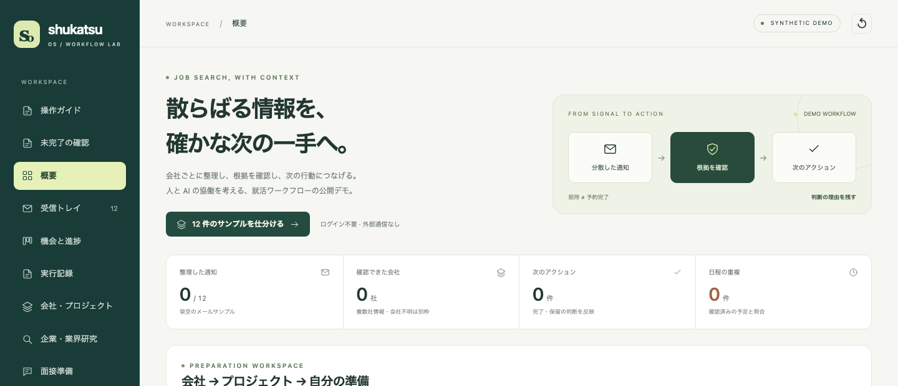

# Shukatsu OS — 散らばる通知から、根拠つきで次の一手へ

就活の通知を会社・募集ごとに整理し、根拠を確認して「次にやること」を選ぶワークフローのデモです。データはすべて架空です。

**▶ [公開デモを開く](https://yaenyanyako.github.io/shukatsu-os-showcase/)**（ログイン不要・外部サービス接続なし・操作ガイドは約6分）

- ケーススタディ：[日本語](docs/case-study.ja.md) · [English](docs/case-study.en.md)
- 私の役割：要件定義・情報設計・受け入れ確認・改善の優先順位付け。コードはAIコーディングツールで生成しています。

[リポジトリの入口](README.md) · [English](README.en.md) · [中文](README.zh-CN.md)

## 2026年11月のツール更新：2つのAIが、共通の記録を確かめてから答える

就活管理に使う私用ツールで、完了した適性検査が別のAI会話では未完了として扱われ、再び対応を求められることがありました。そこで、会話ごとの記憶に頼る運用を見直し、**役割分担・引き継ぎ・回答前の確認**を共通の手順にしました。以下は私用環境の更新です。このリポジトリの公開デモは、架空データで機能を体験するためのものです。

### 1. 2つのAIの分担と、記録の書き込み先を明確にした

| 担当 | 役割 |
|---|---|
| Claude | 書類作成・資料整理。新しい材料と出典、まだ確認できていない点を引き継ぎパックに保存する |
| GPT / Codex | 材料・対象の会社や募集・根拠を独立に確認し、メール照合、正式台帳への登録、読み戻しを担当する |
| 私 | 課題の特定、分担と確認ルールの決定、出力の確認、修正の判断を行う。コードはAIコーディングツールを活用する |

状態の正本は1つの台帳です。Claudeは台帳を直接更新せず、GPTが確認後に正式登録します。書類は新しい版を別ファイルで残し、相手の原稿を上書きしません。

### 2. 「渡した」だけで終わらない引き継ぎにした

引き継ぎには識別ID、対象の会社・募集、材料の保存先と内容照合用のハッシュ、情報源、未確認事項、担当者と次の確認事項を持たせます。GPTは実ファイルを読み、同じIDの二重登録や内容の不一致を確認します。対象が特定できないものは照合待ち、内容が未確認のものは確認待ちとして残します。

**資料の受信・内容確認と、企業への提出は別の状態です。** 草稿が届いたことだけで応募済みにはしません。本人の確認や企業の受付通知など、対象の作業に対応する根拠を確認して記録します。提出済みを選考通過や別テストの完了にも広げません。

### 3. 回答前に、共通の記録と読み取り時点を確認するようにした

1. 作業開始時に、正式台帳の事実・情報源・未確認の報告・不足情報を読む。
2. どの会話が、どの範囲と版を、いつ読んだかを読み取り記録に残す。
3. 状態の回答や催促の前に、記録の版・対象範囲・会話・経過時間を照合する。
4. 更新があった場合や有効時間を過ぎた場合は読み直す。読めないときは「同期未検証」と明示し、古い要約だけで未完了と判断しない。

本人から完了・提出・予約などの確認を受けた場合は、原文と確認日を保存し、根拠つきで台帳へ登録した後、別の接続で読み戻します。確認した日と実際に行った日時も区別します。

### 4. 残っている不一致を、確認事項として見えるようにした

ローカル材料の欠落、ハッシュの不一致、未受信の引き継ぎ、事実の衝突、完了後も残る古い対応事項を点検します。新しい問題には担当者と次の確認事項を残し、解消していないものを黙って完了扱いにしません。

### 結果と限界

変えたのは、共通の根拠を読む手順と、更新する責任の分担です。再発件数や削減時間は未測定です。読み取り確認の成功は、その時点・範囲の記録が新しいことを確かめるもので、事実の正しさ、外部提出の成功、未接続のAI会話への反映を保証しません。引き継ぎには確認待ちが残る場合があります。

更新説明はGitHubの文書にまとめ、デモ画面では通知整理・根拠確認・準備・予定管理の機能を体験できる構成にしています。

## 実際に動く操作と、架空例の境界

| 項目 | このデモでできること・境界 |
|---|---|
| 通知の整理・根拠確認 | JavaScriptで会社・募集への振り分け、日付検証、状態更新、重複排除を実行 |
| 資料・ESの版管理・未完了の確認 | 編集、保存、確認版の選択、過去版の表示、該当作業の完了更新をブラウザ内で実行 |
| 通知本文・企業情報・抽出結果 | 手作業で作った架空例。実メール取得やAIによる抽出は未接続 |
| 企業研究の収集・整理 | 架空の資料IDと出所を保存する模擬操作。外部検索や投稿の取得はしない |
| 面接準備 | 明示的な架空の案内や書類通過の根拠に応じて練習を表示。助言は簡易ルールと固定文 |
| Calendar・PDF・ICS | Calendar接続は模擬同期。架空のPDF・ICS生成とダウンロードは実行可能 |
| メール・採用サイト・外部カレンダー | 未接続。応募、予約、送信、外部サービスへの書き込みは行わない |

## 最初に試すこと

「12 件のサンプルを仕分ける」→ 根拠の通知を読む → 募集ごとの次の行動を確認する。
同じ通知で再実行すると、タスクや予定が増えないことも確認できます。[順番に試す操作ガイド](https://yaenyanyako.github.io/shukatsu-os-showcase/#guide)

ほかに：企業研究の整理、ESの版管理、面接準備、カレンダー連携（模擬）。詳細は[機能一覧](docs/features.ja.md)へ。

## 資料と公開範囲

[検証範囲](docs/evaluation.md) · [今回の更新](CHANGELOG.md) · [公開データの扱い](PUBLIC_DATA.md) · [開発者・保守担当向け](docs/maintainer.md)

この公開デモには、実際の応募者のプロフィール、選考中の企業、書類、メールやアカウントを含めません。例は私用記録の置換ではなく、このデモのために新しく作ったものです。入力はこのブラウザ内だけに保存され、リセットで消せます。AI精度、時間削減や採用成果は測定していません。

公開デモは架空データです。私用環境の集計値は[プロフィール](https://github.com/YAEnyanyako)に記載しています（本人1名、2026年9月27日集計）。件数は利用の規模を示すもので、処理精度や時間削減の測定値ではありません。

MIT License.
