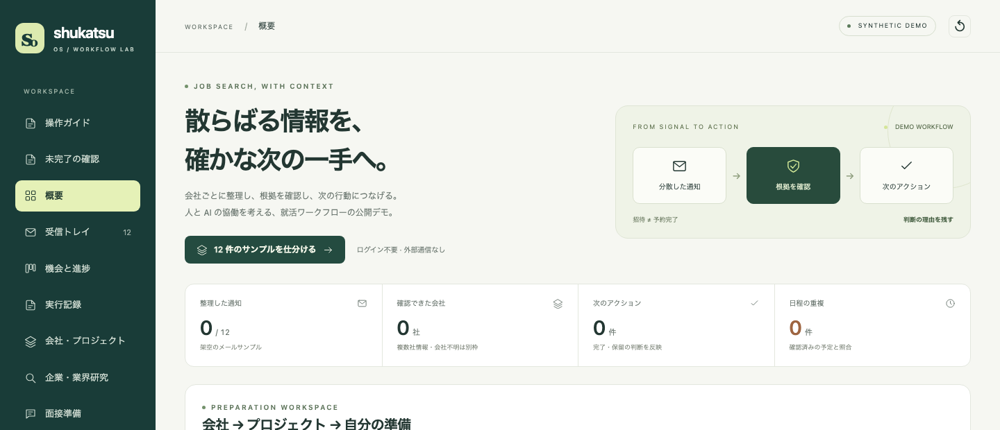

# Shukatsu OS — 散らばる通知から、根拠つきで次の一手へ

就活の通知を会社・募集ごとに整理し、根拠を確認して「次にやること」を選ぶワークフローのデモです。

**▶ [公開デモを開く](https://yaenyanyako.github.io/shukatsu-os-showcase/)**（ログイン不要・まずは約3分で体験）

## このデモで伝えたいこと

- 会社を軸に、文脈をつなぐ。
- 不明な情報は、推測で埋めずに確認待ちへ。
- 新しい根拠が来たら、次の一手を更新する。

## 最初に試すこと

1. サンプルを開く（未整理なら「サンプルを仕分ける」）。
2. 通知の根拠を見て、申込期限とキャンセル期限の違いを確かめる。
3. 日程変更を追加して再実行し、同じ通知でタスクや予定が増えないことを確認する。

**私の役割：** 要件定義・情報設計・受け入れ確認・改善の優先順位付け。コードはAIコーディングツールで生成しています。

## 改善ノート（2026年11月）

完了した適性検査が、別のAI会話で未完了として扱われる問題がありました。  
回答前に共通の記録を読む手順と、2つのAIの役割分担を見直しました。  
[改善の経緯と具体的な確認手順を読む →](docs/improvement-note.ja.md)

## このデモの範囲

データはすべて、このデモのために作った架空例です。編集・版保存・状態更新・PDF／ICS生成はブラウザ内で動作します。実メール、採用サイト、AI、私用台帳、外部カレンダーには接続せず、応募・予約・送信は行いません。入力はこのブラウザ内に保存します。私用環境の改善による再発件数・時間削減は未測定です。

実際に動く操作と、架空例の境界（詳細）

| 項目 | このデモでできること・境界 |
|---|---|
| 通知の整理・根拠確認 | JavaScriptで会社・募集への振り分け、日付検証、状態更新、重複排除を実行 |
| 資料・ESの版管理・未完了の確認 | 編集、保存、確認版の選択、過去版の表示、該当作業の完了更新をブラウザ内で実行 |
| 通知本文・企業情報・抽出結果 | 手作業で作った架空例。実メール取得やAIによる抽出は未接続 |
| 企業研究の収集・整理 | 架空の資料IDと出所を保存する模擬操作。外部検索や投稿の取得はしない |
| 面接準備 | 明示的な架空の案内や書類通過の根拠に応じて練習を表示。助言は簡易ルールと固定文 |
| Calendar・PDF・ICS | Calendar接続は模擬同期。架空のPDF・ICS生成とダウンロードは実行可能 |
| メール・採用サイト・外部カレンダー | 未接続。応募、予約、送信、外部サービスへの書き込みは行わない |

## 資料

[ケーススタディ](docs/case-study.ja.md) · [機能一覧](docs/features.ja.md) · [更新履歴（過去分を含む）](CHANGELOG.md) · [検証範囲](docs/evaluation.md) · [公開データの扱い](PUBLIC_DATA.md)

[English](README.en.md) · [中文](README.zh-CN.md) · [保守担当向け](docs/maintainer.md)

MIT License.
